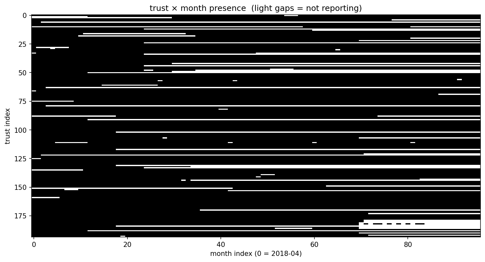
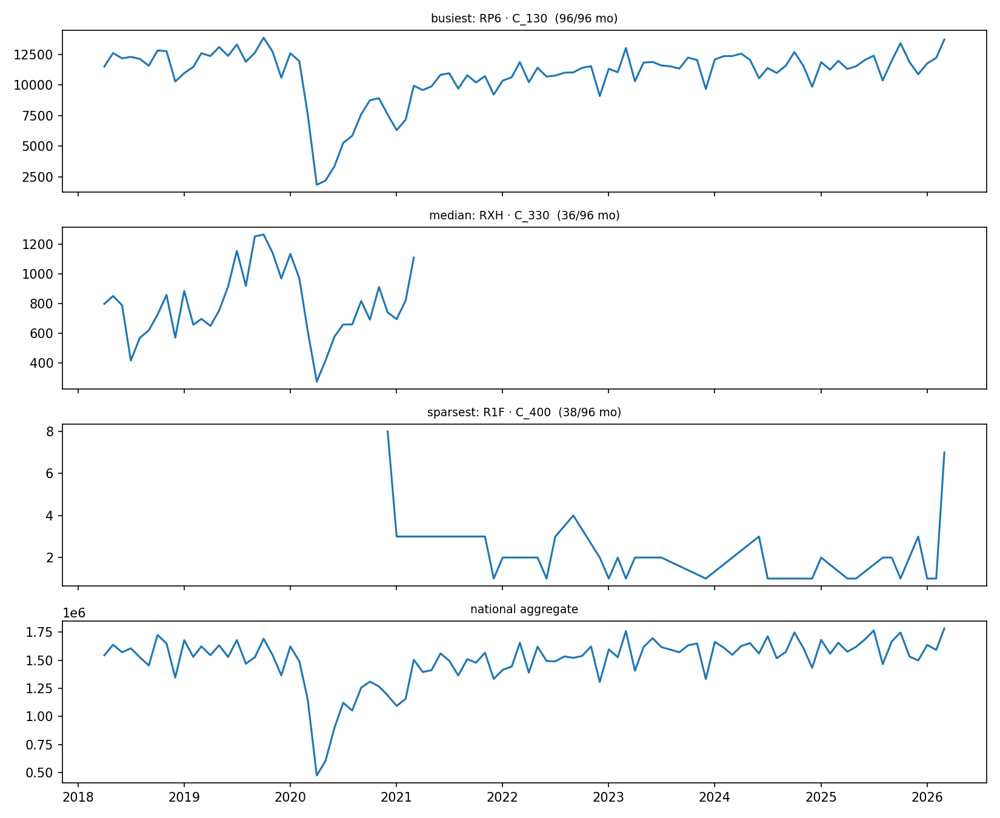
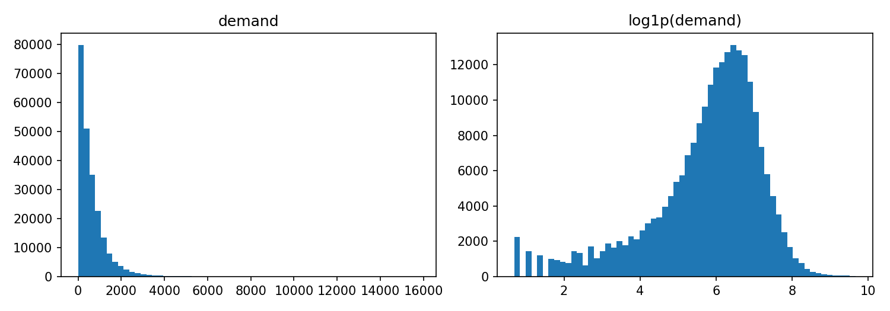
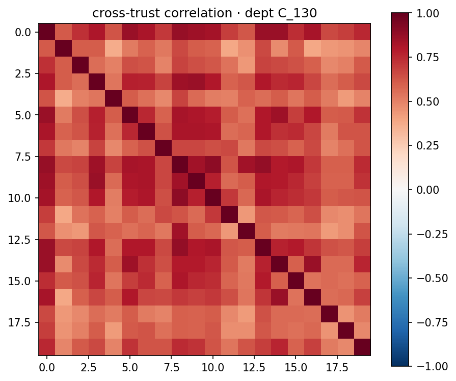

# fedOPD

**Federated OPD demand forecasting — an operations-research prototype.**

Cross-silo federated forecasting of hospital outpatient / departmental demand, where
each provider (hospital trust) participates as a federated client. Providers
collaboratively train a shared forecasting model **without pooling their raw activity
data**.

## Why

Hospital networks want accurate, per-department demand forecasts to plan staffing and
capacity, but patient-level data typically cannot leave each site. Federated learning
lets every provider contribute to a shared model while keeping its own records local.

## Data

This prototype uses **one** real, provider-level, monthly NHS England collection:
**Consultant-led Referral to Treatment (RTT) waiting times**. It is wired up as
multi-site, department-level demand data — see [docs/datasets.md](docs/datasets.md) for
the full, verified schema mapping to the canonical `[date, branch, dept, demand]` table.

| key | collection | grain | fit | window (months) |
|-----|------------|-------|-----|-----------------|
| `rtt` | Referral to Treatment waiting times | provider × treatment function × month | multi-site · dept | 2018-04 → 2026-03 (**96**) |

That's **8 years of monthly history** (96 points) — a ~2-year pre-COVID baseline, the
April-2020 demand collapse (national new-RTT fell to ~31% of baseline), and the full
recovery/backlog — enough to train and back-test seasonal, shock-aware models. Each month
is ~160–196k rows; the provider roster grows over the window (417 → 533 providers, 20 → 24
treatment functions). See [docs/PROJECT.md](docs/PROJECT.md) for the full picture.

## Exploratory data analysis (EDA)

The full EDA runs end-to-end in [`src/eda/EDA.ipynb`](src/eda/EDA.ipynb) (restart-and-run-all, 59 cells, 0 errors)
and is written up as a 25-page report with 10 tables, 7 figures and an F-01..28 findings register —
available as **[PDF](reports/eda_report.pdf)** and **[EPUB](reports/eda_report.epub)**
(source [`reports/eda_report.tex`](reports/eda_report.tex); rebuild with `make -C reports all`).
Headline results:

- **Canonical table** `[date, branch, dept, demand]` — 17,355,150 raw rows → **227,344** rows over
  **96 months × 194 trusts × 24 departments** (3,243 trust×dept series); national `Part_3` totals externally validated 4/4.
- **Balanced panel** — 125 of 194 trusts report in all 96 months (the day-one federation client set; 139 at ≥90 mo, 146 at ≥84 mo).
- **Scale** — demand is heavily right-skewed (skew 4.92); the honest trust-scale spread is ~9× (p90/p10 of mean monthly demand on the balanced panel — the raw 66× lifetime-total figure conflates size with tenure) → per-series scaling + size-aware federated weighting.
- **COVID regime** — national demand collapsed to ~31% of baseline in 2020-04 and recovered to ~116% by 2026-03; kept as a regime flag (with a separate 2023-strike regime), never deleted.
- **Federation evidence** — trusts co-move (median cross-trust correlation 0.63, holding at 0.61 post-2022) and 38% of series carry an annual cycle (37% post-2022), yet differ sharply in scale/casemix → the setting where **personalised** federated learning should win.
- **Bar to beat** — naive-*t*−1 forecasts the held-out year at ~12.6% median sMAPE (seasonal-naive 15.7%); the federated model must beat plain persistence.

| | |
|---|---|
|  |  |
| **Reporting presence** — 125/194 trusts complete all 96 months. | **Series shape** — COVID collapse to ~31% and recovery to ~116% of baseline. |
|  |  |
| **Demand distribution** — heavy right skew (4.92) → per-series scaling. | **Cross-trust correlation** — median 0.63 → shared structure to learn. |

The report also covers the trust-volume spread, autocorrelation (ACF), and calendar-month seasonality
(`reports/figures/{04_trust_volume,05_acf_busiest,06_month_of_year}.png`).

## Setup

```bash
python3 -m venv .venv
.venv/bin/python -m pip install -r requirements.txt   # ~3 GB (CUDA wheels)
.venv/bin/python -m ipykernel install --user --name fedopd --display-name "fedOPD"
```

`requirements.txt` pins `torch==2.11.0+cu128` against PyTorch's CUDA 12.8 index. On a
CPU-only machine, drop the `--extra-index-url` line and the `+cu128` suffix.

Then fetch the data (below) and check the environment:

```bash
.venv/bin/python -c "import torch; print(torch.cuda.is_available(), torch.cuda.get_device_name(0))"
# -> True NVIDIA A100 80GB PCIe MIG 7g.80gb
```

On the A100 server the GPU is exposed through a **MIG `7g.80gb` instance**; `.venv/bin/activate`
auto-selects it via `CUDA_VISIBLE_DEVICES`, so torch uses the A100 with no extra steps. The
instance is not persistent across a reboot — see [docs/PROJECT.md](docs/PROJECT.md) §12 to recreate it.

## Fetch the data

Downloads are driven by a checked-in manifest of verified source URLs
([fetch_scripts/nhs_manifest.json](fetch_scripts/nhs_manifest.json)) and are **idempotent**
(re-running touches only what's missing). Two phases: download each archive, then unzip
its CSV into a specifically-named, analysis-ready folder. Archives are then optional —
the extracted CSVs are the working data — so `--prune-archives` reclaims that space.

```bash
python fetch_scripts/fetch_nhs.py --dataset rtt        # download 96 archives (~329 MB), then unzip (~7.7 GB)
python fetch_scripts/fetch_nhs.py --list               # show the plan; touch nothing
python fetch_scripts/fetch_nhs.py --prune-archives     # delete archives whose CSV is extracted (reclaim space)
python fetch_scripts/fetch_nhs.py --extract-only       # (re)unzip from already-downloaded archives
```

`fetch_nhs.py` is **stdlib only** — nothing to install to run it.

### Refreshing / rebuilding the manifest

The download URLs on NHS England's site carry unguessable hashes, so the manifest is
generated by scraping the official financial-year pages:

```bash
python fetch_scripts/build_rtt_manifest.py             # scrape NHS pages -> fetch_scripts/nhs_manifest.json
```

Run this to add newly-published months (e.g. extend past 2026-03), then re-run
`fetch_nhs.py`.

## Repo layout

```
README.md · CLAUDE.md · requirements.txt
docs/
  datasets.md          NHS RTT provenance + verified schema mapping
  WORKLOG.md           dated register of every work session (standing rule)
fetch_scripts/
  fetch_nhs.py         idempotent, manifest-driven downloader + unzipper (stdlib only)
  build_rtt_manifest.py  scrapes NHS FY pages -> nhs_manifest.json
  nhs_manifest.json    verified source URLs + byte sizes for all 96 monthly files
data/                  all git-ignored:
  archives/rtt/        raw downloads, preserved as fetched (rtt-YYYY-MM.zip)
  nhs_rtt_referral_to_treatment/   unzipped CSVs: rtt_YYYY-MM.csv
```

Data acquisition and documentation only. The canonical loader, EDA, forecaster and
federated loop are **written by hand from here** — nothing is scaffolded for you.

Everything stays under `data/` (git-ignored, nothing scattered through the codebase).
The unzipped CSVs are the working data; raw archives are transient and re-fetchable from
the manifest. The manifest is the reproducible record of exactly what was fetched.

## Design (target)

- **Swappable forecaster** behind a small `get_params` / `set_params` interface, so the
  model can be replaced (NumPy → PyTorch) without touching the federated loop.
- **Cross-silo, client-per-provider.** Each provider is a client; a coordinator
  aggregates model updates (e.g. FedAvg / FedProx) with optional per-client
  personalisation.

## Status

Data acquisition, the canonical build, and the full 8-stage EDA are complete (see
[Exploratory data analysis](#exploratory-data-analysis-eda) above, and
[`reports/eda_report.pdf`](reports/eda_report.pdf)). Next: the swappable forecaster
interface (`get_params` / `set_params`) and the Flower cross-silo federated loop over the
recommended 125-trust panel.

## Licensing

NHS data is © Crown copyright, NHS England, under the
[Open Government Licence v3.0](https://www.nationalarchives.gov.uk/doc/open-government-licence/version/3/).
Raw files are **not** redistributed here — fetch them with `fetch_scripts/fetch_nhs.py`.

Source: <https://www.england.nhs.uk/statistics/statistical-work-areas/rtt-waiting-times/>
