# fedOPD: Federated + Agentic Decision Support for NHS Waiting Lists

This project builds a **federated, agentic AI system** to support strategic planning and resource allocation across NHS hospitals using Referral to Treatment (RTT) waiting‑time data.

**Goal:**  
Use historical RTT data (2018–2026) to:
- Forecast demand and waiting‑list pressure at the **provider × specialty** level.
- Compare **full‑history** vs **post‑Covid** modeling regimes.
- Design **agent policies** that:
  - Detect temporary spikes vs sustained pressure.
  - Recommend redistribution of demand, capacity expansion, or use of independent‑sector capacity.
- Explore a **federated learning** setup where each hospital (or ICB) trains local models and a central “board agent” aggregates knowledge without centralising raw data.

The first milestone is a **clean, audited RTT panel** and a set of reproducible notebooks that prove key data properties before any modeling.

## Status at a glance (from notebook stored outputs, 2026-07-29)

- **Milestone 1 delivered**: audited 96-month RTT panel → flagged panel → canonical panel with capacity (`data/processed/rtt_kh03_canonical_panel.csv`, 343,441 × 24). All six notebooks run headless end-to-end with zero errors; every documented claim has its implementing code line.
- **Sealed test year: FY 2025-26** — declared in `04_baseline_forecasting.ipynb`, excluded by assert, untouched until the one-shot final evaluation.
- **Standing result — the forecasting question is closed at this grain**: naive persistence is unbeaten on MAE at *every* horizon from 1 to 12 months (154 / 317 / 501 / 742 on FY 2024-25 validation targets), by every signal in the raw files — linear, gradient boosting, drift, seasonality, and the `Part_3`/`Part_1` flows (notebooks 04, 07–09). Waiting lists carry no usable seasonality at any horizon. One crack: net-flow linear beats naive on RMSE at 1 month (328 vs 330).
- **New capability**: conformal 90% bands around persistence, calibrated on FY 2023-24 and honestly covered on FY 2024-25 (87.6–89.6%): ±298 (1m) to ±1,714 (12m) patients — the uncertainty input for allocation decisions.
- **Agent prototype built, v1 + v2** (notebook 10): declared-weight pressure score + 6-month band, 2,337 simulated decisions with known outcomes. v1 lesson: growth-risk triggers select no extra realized growth — rules must condition on *current* pressure. v2 (within-ICB OUT/IN): classes separate real populations, but only **13.6%** of OUT flags have an in-ICB receiver — redistribution needs cross-ICB or independent-sector receivers. Constants pending supervisor ratification.
- **FL phases 1 + 2 run** (notebook 11): naive level-FedAvg actively hurts (186.5 / 228.8 — the non-IID failure, measured), but **delta-space federation repairs it completely**: fedavg-delta 154.0, within 0.2 of centralized pooling (153.8), raw data never leaving the client. Remaining: scale toward the 392-provider pool and neural clients.
- **Coarser grains closed** (notebook 12): persistence wins at every horizon at ICB (310/657/1,077/1,523) and national grain (3,777/5,652/8,928/9,580) — **the random walk holds at provider, ICB and national level. Forecasting is closed at every grain and horizon measured.**

Full evidence trail: `docs/eda_rtt_summary.md` (results + goals-vs-evidence table) and `docs/idea_canonical_pipeline.md` (pipeline design record).

---

## Pipeline at a glance

Arrows are data flow; node labels state what was *measured*, not what was hoped — the forecast layer is persistence because nothing beat it, agents condition on current pressure because predicted growth selects nothing, and FL matches pooled training without beating persistence.

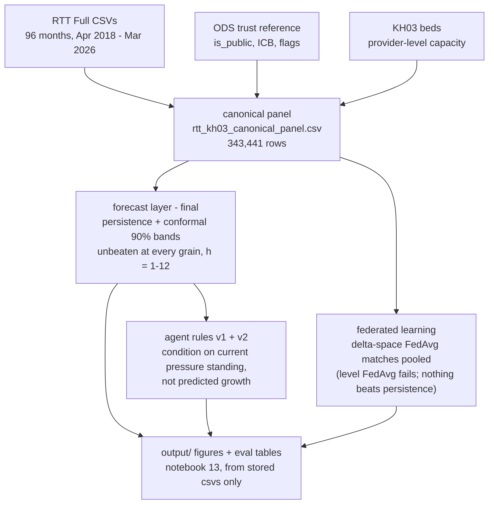

## Data sources

All data are from **NHS England**:

- **RTT (Referral to Treatment) Full CSVs**  
  Monthly provider‑level waiting‑time data, April 2018 → March 2026 (96 months).  
  One file per month, with rows for:
  - Provider (trust / independent)
  - Commissioner (ICB / CCG)
  - Specialty (treatment function)
  - Waiting‑time bands (by weeks)  
  [NHS RTT waiting times](https://www.england.nhs.uk/statistics/statistical-work-areas/rtt-waiting-times/)

- **ODS Organisation Data**  
  Reference data for NHS organisations (trusts, ICBs, etc.), used to:
  - Map provider codes to trust names and ICBs.
  - Classify providers as public vs independent.  
  [ODS Data Search & Export](https://www.england.nhs.uk/nhs-it/standards-and-guidance/organisation-data-service-ods/)

- **KH03 Bed Availability & Occupancy** *(planned)*  
  Quarterly bed‑level capacity data (available/occupied bed days) by specialty.  
  Will be merged with RTT to add a **capacity** dimension to the demand/waiting signals.

---

## What has been done so far

All work is in the `src/` folder as Jupyter notebooks. Results and processed data live under `data/`.

### 1. Data fetch (`src/01_fetch_dataset.ipynb`)

- Scraped and downloaded **96 monthly RTT Full‑CSV zips** (April 2018 → March 2026) from the 8 NHS year pages.
- Verified each download:
  - HTTP status checked (`raise_for_status`).
  - ZIP integrity checked (`ZipFile.testzip()`) before final rename.
- Downloaded:
  - ODS trust → ICB reference (~544 trusts).
  - 61 KH03 overnight bed spreadsheets (for later integration).

Outputs:
- `data/rtt_zips/` – 96 raw zips.
- `data/rtt_csv/` – 96 extracted CSVs.
- `data/reference/trust_icb.csv` – ODS trust/ICB mapping.
- `data/kh03/` – KH03 spreadsheets.

---

### 2. Dataset audit (`src/02_eda_dataset.ipynb`)

Every file was inspected **before** any processing.

**Integrity checks (all passed):**

| Check | Result |
|---|---|
| Files on disk | 96 CSVs, 96 zips |
| Month coverage | 96/96 months present, no gaps |
| `Period` inside file vs filename | Matches in all 96 files |
| Schema generations | Exactly 2 column sets: 69 cols × 36 files, 121 cols × 60 files |
| Schema break | One break only, at `20210430-RTT-APRIL-2021` (extended 52+ week bands added) |
| `C_999` aggregate proof | Apr 2018: C_999 row = 4,037,223 = sum of real specialty rows (asserted) |
| File manifest | Sizes + SHA‑256 for all 96 files → `data/reference/rtt_manifest.csv` |

**Key traps proven and handled:**

- **C_999 “Total” specialty row**  
  Exactly equals the sum of the real specialty rows; including it doubles every figure.  
  → Excluded from the panel.

- **Part types**  
  Five part types exist: `Part_1A`, `Part_1B`, `Part_2`, `Part_2A`, `Part_3`.  
  - `Part_2` = incomplete pathways (the waiting list).  
  - `Part_2A` = incomplete pathways **with** a decision to admit (subset of `Part_2`).  
  National totals confirm `Part_2A ⊂ Part_2`.  
  → Panel keeps only `Part_2` to avoid double counting.

---

### 3. Canonical RTT panel

`data/processed/rtt_incomplete_panel.csv`

- **343,441 rows × 8 columns**
- One row per **(month, provider_code, tfunc_code)**, incomplete pathways only.
- Columns:
  - `month`
  - `provider_code`
  - `tfunc_code`
  - `total_waiting`
  - `gt18` (patients waiting **over** 18 weeks — sum of bands from `Gt 18 To 19` up)
  - `gt52` (patients waiting **over** 52 weeks)
  - `pct_gt18`
  - `pct_gt52`

Coverage:
- 96 months (Apr 2018 → Mar 2026)
- 651 providers ever seen
- 24 specialties

Long‑wait columns are constructed by summing all week bands ≥ 18 / ≥ 52 weeks, which works consistently across both the 69‑col and 121‑col schema generations.

**Public vs independent providers**

- Matched against ODS RO197 trust list (`data/reference/trust_icb.csv`):
  - 193 of 651 provider codes are NHS trusts → hold **94.5%** of total waiting list.
  - 458 are independent‑sector providers → hold **5.5%**.
- Decision: **keep independents, but flag them** (`is_public` = membership in ODS trust list).  
  They are important for the “private capacity” storyline, even if they barely move national figures.

**Specialty concentration**

Share of all patient‑months:

- C_110 Trauma & Orthopaedics: 11.6%
- C_130 Ophthalmology: 9.1%
- C_120 ENT: 8.0%
- C_502 Gynaecology: 7.4%
- C_100 General Surgery: 6.4%
- Remaining 19 specialties: each < 6%

No single specialty dominates; the system is broadly diversified.

---

### 4. Headline descriptive results

Means of the England‑wide monthly series (denominator: total incomplete waiting list that month):

| Era | Mean waiting list | % > 18 weeks | % > 52 weeks |
|---|---|---|---|
| Pre‑Covid (Apr 2018 – Feb 2020, 23 months) | 4,283,000 | 13.9% | 0.05% |
| Post‑Covid (Mar 2020 – Mar 2026, 73 months) | 6,574,296 | 38.8% | 4.11% |

- Waiting list grew **53.5%** post‑Covid.
- The **>52‑week share rose ~80×** (0.05% → 4.11%, 81× on the era means).
- This shows that long waits grew far faster than the list size, justifying agent policies that explicitly track **age** of backlog, not just volume.

Detailed plots and evidence are in `src/02_eda_dataset.ipynb`.

---

### 5. Provider flags (`src/03_provider_flags.ipynb`) — DONE

- ODS joined onto the panel: `trust_name`, `status`, `icb_code`, `is_public`.
- Per‑provider stability: `n_months_active` (median 89 of 96), `first_month`, `last_month`.
- Declared flags (thresholds chosen 2026‑07‑29, not tuned):
  - `fl_client` (≥ 48 months + reporting in the final data month): **392 providers**.
  - `fl_allocatable` (public + ≥ 24 months): **182 providers**.

Output: `data/processed/rtt_panel_with_provider_flags.csv` (343,441 × 18).

---

### 6. Sealed test year & baseline forecasting (`src/04_baseline_forecasting.ipynb`) — DONE

- **Sealed test year declared: FY 2025‑26** (Apr 2025 – Mar 2026). 43,248 rows excluded up front, asserted; final evaluation happens once, at the end of the project.
- One‑month‑ahead `total_waiting`, C_110 at 130 stable public providers, validated on 1,407 FY 2024‑25 rows:

| model | MAE | RMSE |
|---|---|---|
| naive persistence (next = this month) | **153** | 330 |
| pooled linear, full history | 156 | 330 |
| pooled linear, post‑Covid only | 154 | 330 |

- **Persistence is unbeaten** — monthly waiting lists are near‑random‑walk. A useful model must add structure (seasonality, referral inflow from `Part_3`, capacity), not just refit current level + trend.

Output: `data/processed/val_forecasts_c110_public_clients.csv`.

---

### 7. KH03 capacity & the canonical panel (`src/05_kh03_beds.ipynb`, `src/06_merge_canonical.ipynb`) — DONE

- All 61 KH03 files share one layout (`NHS Trust by Sector` sheet); 60 unique quarters, Apr 2011 → Q4 2025‑26, 12,453 provider‑quarters.
- **Reality check vs the plan:** KH03 reports *sectors* (General & Acute, Learning Disability, Maternity, Mental Illness), not treatment specialties, and *Available* exists only by sector — so capacity is a **provider‑level** signal, repeated across a provider's specialty rows in the merge. Values are **average daily beds**, not bed‑days.
- Data traps handled (each proven in stored outputs): a duplicate Q4 2014‑15 file (revised wins), a `"2013-15"` year typo in the Q2 2013‑14 file, `-` markers where available = 0 (2,117 provider‑quarters with zero G&A beds → NaN occupancy, not 0). Column positions verified by recomputing occupancy and asserting equality with the sheet's own `% Occupied` column.
- Merge (left join on provider × month, row count preserved): public trusts **99.0%** capacity coverage, independents 0.1% (KH03 is an NHS‑trust return), overall 66.2% of rows.

Outputs: `data/processed/kh03_monthly_panel.csv` (37,359 × 8) and the **canonical panel** `data/processed/rtt_kh03_canonical_panel.csv` (343,441 × 24). Design record: `docs/idea_canonical_pipeline.md`.

---

### 8. First structured models (`src/07_beat_persistence.ipynb`) — DONE

Gradient-boosted trees (`HistGradientBoostingRegressor`, seed 42) predicting the one‑month **change** in `total_waiting` — trees cannot output levels beyond their training range, and FY 2024‑25 contains a new all‑time high (18,758 vs 18,453 max in training), so the raw‑level variant is fitted only as evidence. Features: current level, backlog age (`pct_gt18`, `pct_gt52`), 1/2/3‑month momentum, calendar month, G&A occupancy (NaN handled natively — no imputation). Same cohort, splits and validation rows as notebook 04, asserted (recomputed naive MAE = 153 exactly).

All variants, MAE on the same 1,407 FY 2024‑25 rows:

| model | full‑history | post‑Covid |
|---|---|---|
| naive persistence | **153** | — |
| gbm on change | 155 | 158 |
| gbm on level | 178 | 174 |
| drift (mean change) | 156 | 158 |
| seasonal drift (per‑calendar‑month mean change) | 158 | 162 |

**Persistence still unbeaten.** Seasonal drift loses to plain drift — calendar patterns don't transfer to FY 2024‑25 — and occupancy has near‑zero permutation importance (0.20 vs 10.18 for current level). Output: `data/processed/val_forecasts_c110_gbm.csv`.

---

### 9. Referral inflow & completion outflow (`src/08_part3_flows.ipynb`) — DONE

The last unused raw signals: `Part_3` (new RTT periods = referrals in) and `Part_1A/1B` (completed pathways = treated patients out), built into `data/processed/rtt_flows_panel.csv` (338,265 × 5). Schema fact checked before building: `Part_3` carries its count **only** in `Total All` — its week-band columns are empty in both schema generations.

- **National evidence**: net flow (referrals − completions) correlates **0.74** with the actual monthly change in the list (n = 95 months), but overshoots ~8× — mean monthly net flow 265,730 vs mean actual change 31,666. Patients leaving without treatment (not counted by `Part_1`) absorb the difference.
- **Forecast test** (same 1,407 validation rows as 04/07, asserted): net-flow identity MAE 250; net-flow linear MAE 154 / **RMSE 328 — the project's best RMSE** (naive: 330), fitted slope 0.08–0.13; gbm-with-flows MAE 155/158. **Persistence still unbeaten on MAE.**

Output: `data/processed/val_forecasts_c110_flows.csv`.

---

### 10. Longer horizons & the uncertainty layer (`src/09_longer_horizons.ipynb`) — DONE

1/3/6/12-month-ahead forecasts with splits by **target month** (an origin split would let a 12-month forecast validate on the sealed year; asserted impossible here). All figures from stored outputs, FY 2024-25 validation targets:

| horizon | persistence MAE | best challenger | conformal 90% band (coverage) |
|---|---|---|---|
| 1-month (n=1,534) | **154** | gbm+flows 156 | ±298 (89.0%) |
| 3-month (n=1,532) | **317** | drift 331 | ±649 (88.7%) |
| 6-month (n=1,529) | **501** | drift 538 | ±1,053 (87.6%) |
| 12-month (n=1,524) | **742** | drift 847 | ±1,714 (89.6%) |

**Persistence wins at every horizon and its lead widens with distance.** Same-month-last-year scores MAE 742 at every horizon (it always forecasts from the target's month−12 value) — waiting lists carry no usable seasonality. The conformal bands are calibrated on FY 2023-24 targets and their coverage measured on FY 2024-25, a year the calibration never saw. Output: `data/processed/val_horizons_c110.csv`.

---

### 11. Agent prototype (`src/10_agent_logic.ipynb`) — BUILT, constants pending ratification

Phase B's first build, on persistence + bands. All constants **declared 2026-07-30, not tuned** (pressure weights 0.2/0.6/0.2 on within-month percentile ranks of `pct_gt18`/`pct_gt52`/`occupancy_ga`; thresholds 0.70/0.40, 1.20/1.05, 0.80). Cohort: C_110 at 150 public allocatable providers; band recomputed for this cohort (±1,171, calibrated on 7,357 rows with targets before Apr 2023); 2,337 decisions simulated (Apr 2023 – Sep 2024), each checked against its actual 6-month outcome.

- EXPAND_CAPACITY fired on **334 / 2,337** provider-months at 30 trusts — the top ten trigger in all 18 possible months (persistent pressure, not spikes).
- **Two of four proposed rules are arithmetically dead** with an absolute band under persistence (OUT needs lower-edge > current; IN's stability test needs a list ≥ 23,420 — larger than any C_110 list). Documented, not coded.
- **Reality check**: EXPAND months preceded *no more* growth than status quo (median realized 6-month change +0.5 vs +37 patients; 50.0% vs 53.5% grew) — the random-walk result reaching policy: allocation rules must condition on **current measured pressure**, not predicted growth.

**v2 — redistribution on within-ICB standing** (same notebook; declared thresholds OUT ≥ 0.80 / IN ≤ 0.30 on within-ICB pressure and occupancy ranks): OUT 457 / IN 105 / STATUS_QUO 1,775. The classes separate real populations (OUT median pressure 0.723, realized 6-month change +81; IN 0.183, +5). **Only 13.6% of OUT flags have an in-ICB receiver** (ICB groups: min 1 / median 3 / max 10 providers) — the receiving side needs cross-ICB pooling or the independent sector; single-provider ICBs auto-flag OUT (rank 1.0 by construction) and need a minimum-group rule.

Output: `data/processed/agent_decisions_h6_c110.csv` (2,337 × 17).

---

### 12. First federated-learning experiment (`src/11_federated_learning.ipynb`) — DONE

The FL question is collaboration, not beating persistence: 128 C_110 clients, linear on (level, momentum), declared splits unchanged, all models scored on the same 1,407 validation rows.

| model | full-history MAE | post-Covid MAE |
|---|---|---|
| naive persistence | **153.5** | — |
| pooled (centralised) | 153.8 | 155.4 |
| local-only | 161.9 | 166.5 |
| FedAvg (weighted coefficient average) | 186.5 | 228.8 |

**Naive FedAvg actively hurts** — averaging raw-scale coefficients across clients whose lists span ~50 to ~18,000 patients breaks the intercept (the classic non-IID failure, measured; FedAvg beats local at only 41.4% of clients). Cold start measured too: RJ8's C_110 series starts May 2024 (zero training rows) — local-only falls back to persistence, the shared model can serve it.

**Phase 2 repairs it**: federating in **delta space** (each client fits *change* = a + b·momentum; coefficients averaged) scores **154.0 / 155.5** — the full 32.5-point loss recovered, within 0.2 MAE of centralized pooling, raw data never leaving the client. Slope-only sharing with local intercepts is slightly worse (155.3 / 157.4). Headline: once the shared quantity is scale-free, privacy-preserving federation matches centralization on this data. Outputs: `fl_summary_c110.csv`, `fl_per_client_c110.csv`.

---

### 13. Coarser grains (`src/12_coarser_grain.ipynb`) — DONE

The same C_110 series aggregated to ICB (35 series) and England, constant membership only (115 providers present in all 96 months). Persistence wins at every horizon at both grains — ICB MAE 310 / 657 / 1,077 / 1,523 (n=420), national 3,777 / 5,652 / 8,928 / 9,580 (n=12); seasonal never competitive; drift blows up at long national horizons (48,009 at 12 months — it extrapolates training-era growth that flattened). **The random walk holds at provider, ICB and national grain.** Output: `val_horizons_coarse_c110.csv`.

---

### 14. Report artifacts (`src/13_report_figures.ipynb`) — DONE

Report-only layer: 6 figures + 9 evaluation tables + `output/README.md` (a provenance manifest mapping every artifact to its source csv), all under `output/`, generated **only from stored `data/processed/` csvs** — nothing recomputed, every documented value pinned by assert. Highlights: persistence-MAE stability tables (by origin month: 123.3–221.9; by provider: long tail, worst RXC 725.2 over the 128 providers with FY 2024-25 rows); pre/post era tables at national, specialty, provider and provider×specialty grain (aggregate rates, denominators stated); a three-window agent stress test — class sizes and pressure separation stable across windows, realized-change medians not (the random walk in policy terms). Audit spec and verification record: `CODE_AUDIT.md`.

---

### 15. FL scale-up across specialties (`src/14_fl_scaleup.ipynb`) — DONE

Notebook 11's delta-space protocol, one loop, no per-specialty tuning: all 24 specialties × 149 public `fl_client` providers (26,504 FY 2024-25 validation rows; the C_110 row asserted to reproduce 11 exactly). **Federation ≈ pooled at every specialty** (fedavg-delta − pooled MAE gap: median −0.08, worst +1.27, best −4.61). New scope finding: **the random-walk closure is C_110-scoped** — a 1-month delta model edges persistence at 12 of 24 specialties (largest −6.5 MAE at C_120: 165.1 vs 171.6, n=1,265), while persistence still wins at C_110 and 11 others (models worst at X02: 153.2 vs 144.2). Whether ≤6.5-MAE margins justify a model layer at those specialties is a supervisor question. Output: `fl_scaleup_by_specialty.csv` (24 × 22).

---

### 16. Neural FL clients (`src/16_fl_neural_clients.ipynb`) — DONE

The first neural experiment (15 was reserved at the time and now holds the frozen agent rules): one GRU client architecture declared a priori (hidden 32, 6-month windows of level/momentum/wait-shares, FedAvg 10 rounds × 5 local Adam steps, seed 42 — no sweeps, no early stopping), all 23 scored specialties, every model rescored on identical window-eligible rows. **Aggregate: neural ≈ linear** (beats linear FedAvg at 11 of 23 specialties, 55.2% of 2,441 client pairs; median MAE gap +0.15). **The C_110 anchor cracks for the first time** — neural pooled 150.6 / neural FedAvg 152.4 vs persistence 154.1 on the same 1,401 rows — but single-seed among 184 computed scores, so a declared multi-seed robustness check is the honest next step (supervisor decision). Best delta-R² anywhere: +0.075. Outputs: `fl_neural_summary.csv`, `fl_neural_per_client.csv`, `output/figures/fl_neural_vs_linear.png`.

---

### 17. Comparison figures, image harvest and decision sheet (`src/13`, `src/18`, `docs/`) — DONE

Notebook 13 gained a cross-model comparison section — four figures, all from stored csvs (its manifest now lists 19 artifacts): linear vs neural at C_110 on identical rows; the per-specialty neural−linear gap (a coin flip); the per-specialty Covid regime effect (post-only training costs up to +3.3 MAE linear / +2.4 neural; the X-codes sit at zero — no pre-Covid rows to drop); and gap vs dataset size (Pearson r = 0.128 — size does not decide the winner; the biggest relative neural wins are the four X-codes, exactly the specialties with no pre-Covid history). New `src/18_extract_figures.ipynb` harvests every image embedded in the executed notebooks into `output/figures/from_notebooks/` with a manifest (17 images from 4 notebooks — the modelling notebooks print tables rather than draw inline figures, by design). `docs/supervisor_decision_sheet.md` collects the four pending decisions that unblock notebook 15 (frozen agent rules) and notebook 17 (sealed one-shot).

---

### 18. Frozen agent rules (`src/15_agent_rules_frozen.ipynb`) — DONE

The four decision-sheet calls were made by the project owner on 2026-07-30 (recorded in `docs/supervisor_decision_sheet.md` — the supervisor reviews the final draft; nothing is presented as external sign-off). Constants ratified as declared, no value changed; the notebook re-derives both decision columns from the stored component columns and **asserts bit-for-bit equality** with notebook 10's stored decisions on all 2,337 provider-months, so the freeze is proven rather than copied. Receiving side: in-ICB only, with the minimum group of 4 providers already enforced arithmetically by the ratified 0.30 threshold (asserted); the externally proposed "≥ 30 validation rows" rule was rejected as impossible (the largest provider group has 18 rows — asserted). Newly measured: 246 of 457 OUT months (53.8%) sit in sub-4-provider ICBs where no local receiver is ever possible. Output: `agent_frozen_summary.csv`. A recount fixed a doc error: the simulation covers **132 providers**, not 150.

---

### 19. Multi-seed check of the C_110 neural result (`src/19_neural_c110_multiseed.ipynb`) — DONE

Seeds 42/123/999 and the verdict rule declared before running; implementation copied verbatim from 16 so only the seed varies; every seed reported. **Verdict: CONFIRMED in the full regime for both models** — neural pooled 151.5 ± 0.9 MAE (150.6/152.2/151.9) and neural FedAvg 152.4 ± 0.0 (152.4/152.3/152.4), all below persistence 154.1 on the same 1,401 rows. Post regime reported as-is: FedAvg 3 of 3 seeds, pooled 2 of 3 (seed 123 lands exactly on 154.1). The FedAvg spread of ±0.0 makes sense: averaging weights across ~128 clients washes out initialization noise. Output: `fl_neural_c110_multiseed.csv` (12 × 6). Run in its own notebook so 16's stored csvs (and 13's asserts pinned to them) are not perturbed by a nondeterministic cuDNN re-run.

---

### 20. Sealed-year one-shot (`src/17_sealed_year_eval.ipynb`) — DONE, run exactly once

FY 2025-26 read for the first and only time (2026-07-30, on explicit instruction), with a pre-registration cell fixing everything before execution: h=1 forecast layer, full-history regime, linear in two declared cuts (val-frozen and final), neural final cut at seed 42, targets May 2025 – Mar 2026. **The C_110 anchor returns to persistence**: sealed persistence 151.5 vs neural pooled 151.6 (n=1,407) — the validation-confirmed neural edge did not replicate prospectively. In aggregate the delta models strengthened: neural pooled beats persistence at 15 of 23 specialties (13 on validation), neural FedAvg and linear-final at 14. Per-specialty persistence MAE drifted by a median +4.6% vs the validation year (−51.1% to +38.2%) — the year moves more than the models. Output: `sealed_year_eval.csv` (161 × 8, validation MAE joined beside every sealed score). The agent simulation and band coverage on the sealed year were deliberately out of scope. **This notebook is never re-run.**

---

## Results gallery (`output/`)

Every chart below is generated by `src/13_report_figures.ipynb` from stored result csvs (one exception noted); **[`output/RESULTS.md`](output/RESULTS.md)** is the headline-results list, generated the same way — no number in it is typed by hand. **[`output/RUNS.md`](output/RUNS.md)** is the run log — per-notebook execution status, last-run time (UTC) and each notebook's stored verdict print, generated from the .ipynb files by `src/18_extract_figures.ipynb`. The full processed dataset (`data/processed/`, including the derived panels) is tracked in this repo; only the ~8.5 GB raw NHS downloads and the venv are gitignored, both reproducible via `src/01`–`06`. `output/figures/from_notebooks/` additionally holds every image embedded in any executed notebook, harvested by `src/18_extract_figures.ipynb` with a manifest mapping each png to its notebook and cell.

### National picture

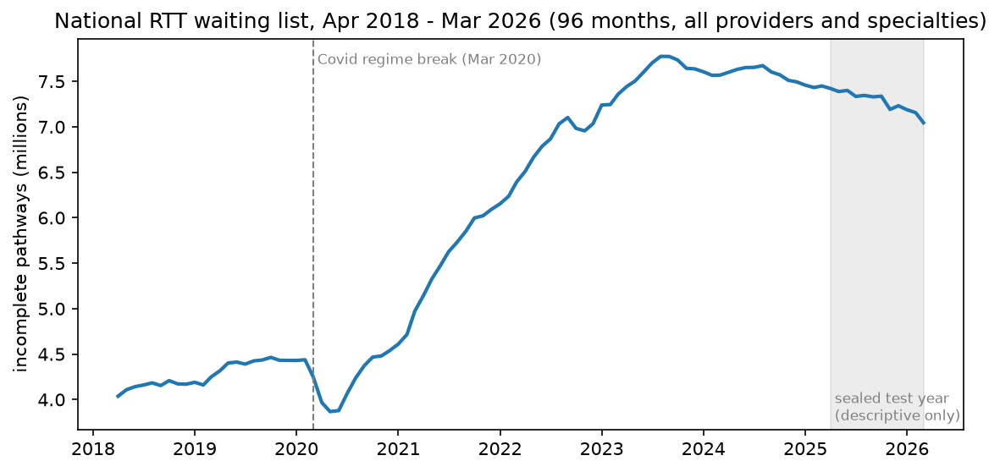
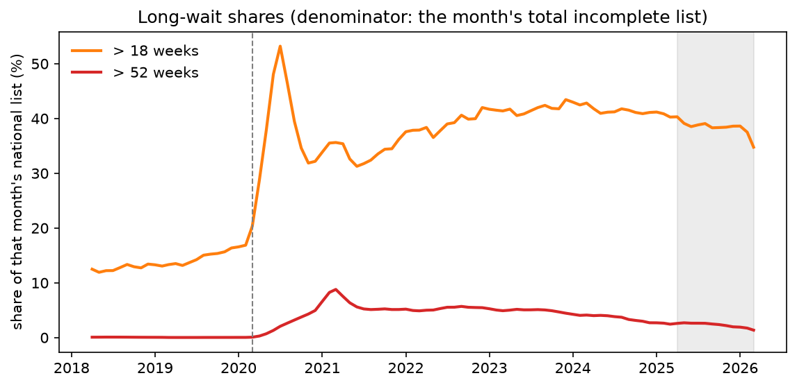

### Forecasting (validation FY 2024-25)

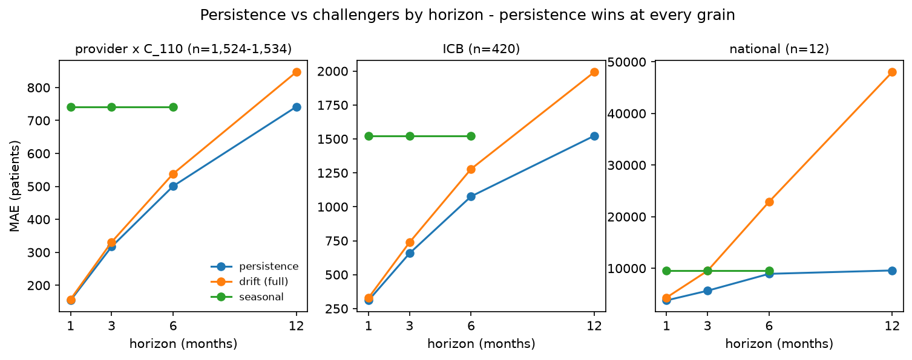
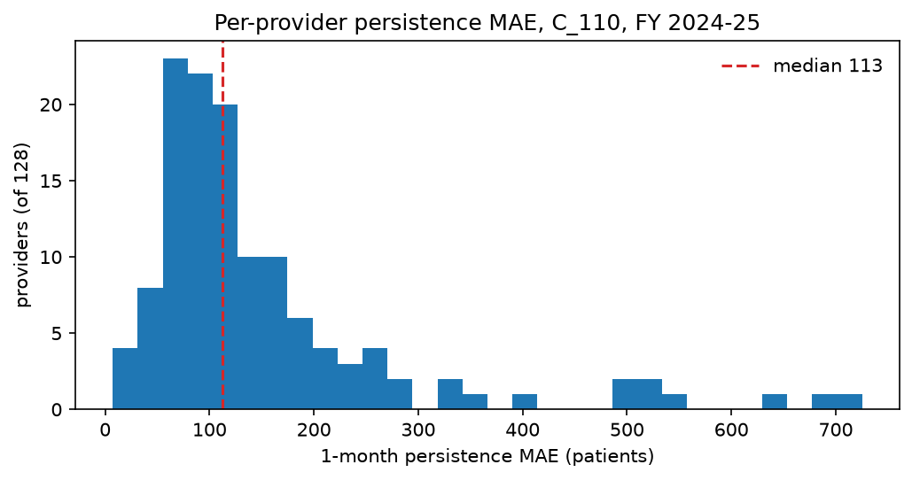

### Agent rules

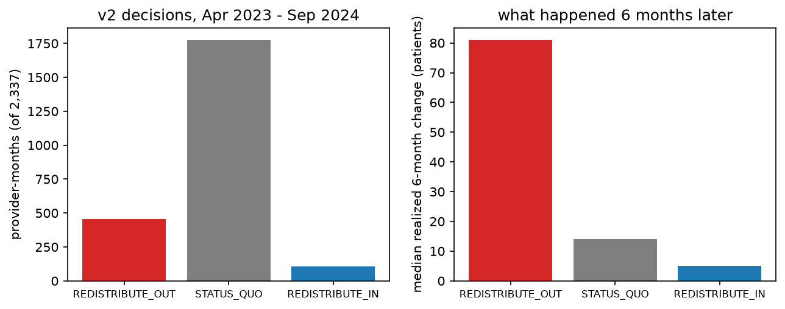

### Federated learning

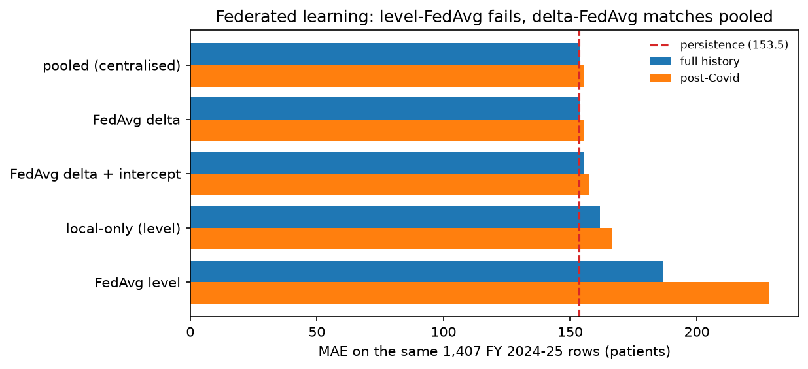
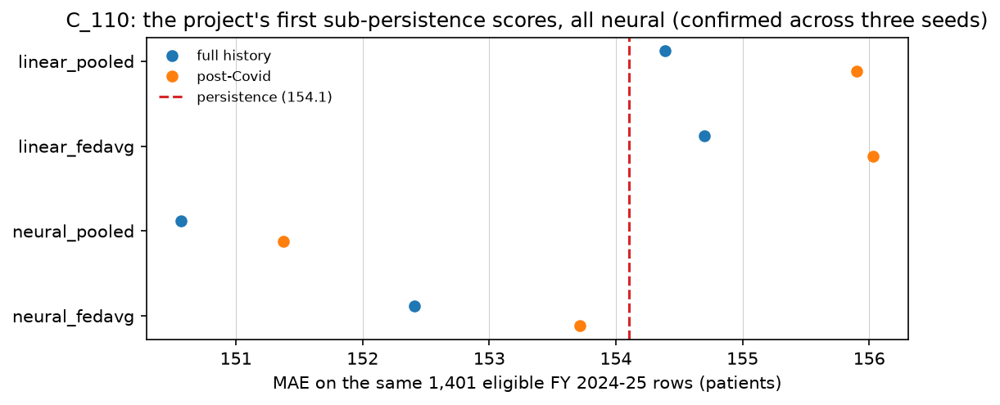
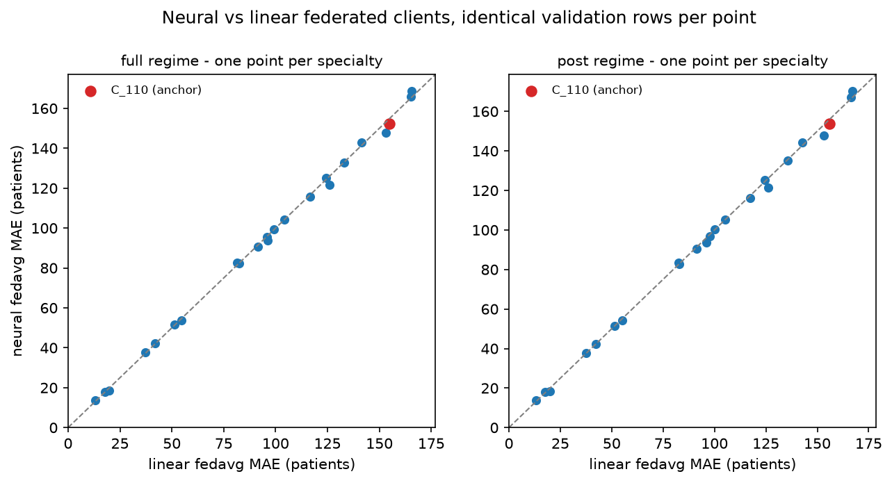
*(the scatter above is written by `src/16_fl_neural_clients.ipynb` — the one non-13 figure)*
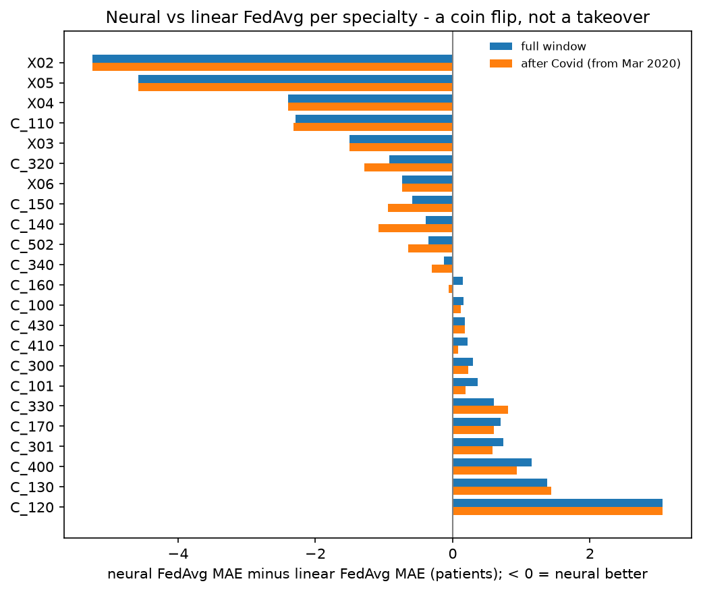
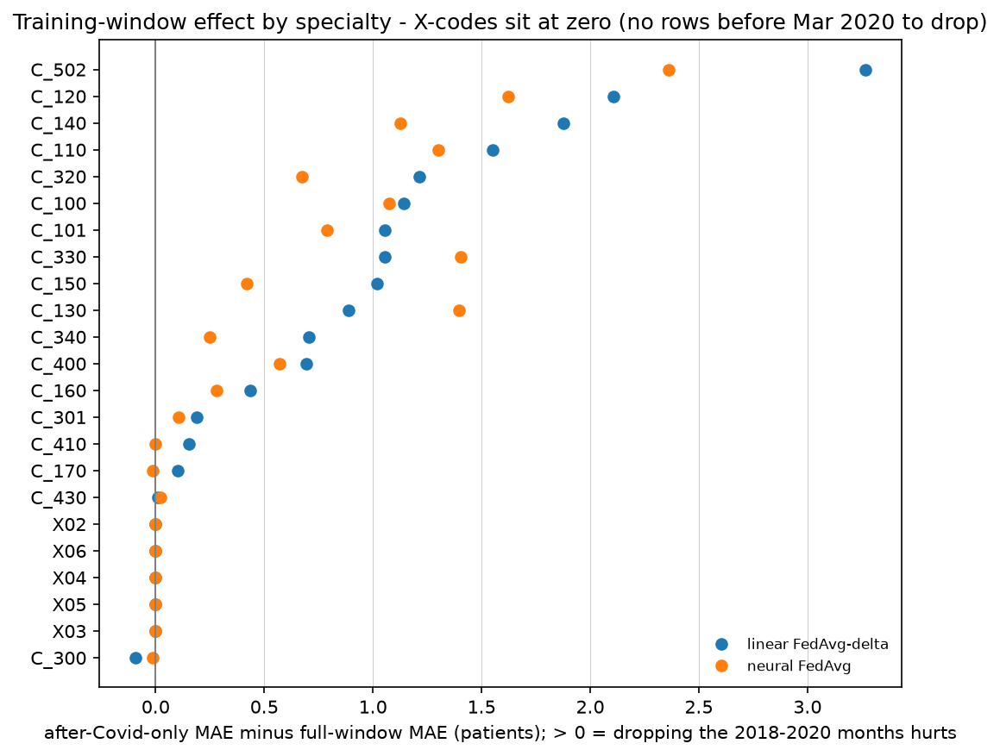
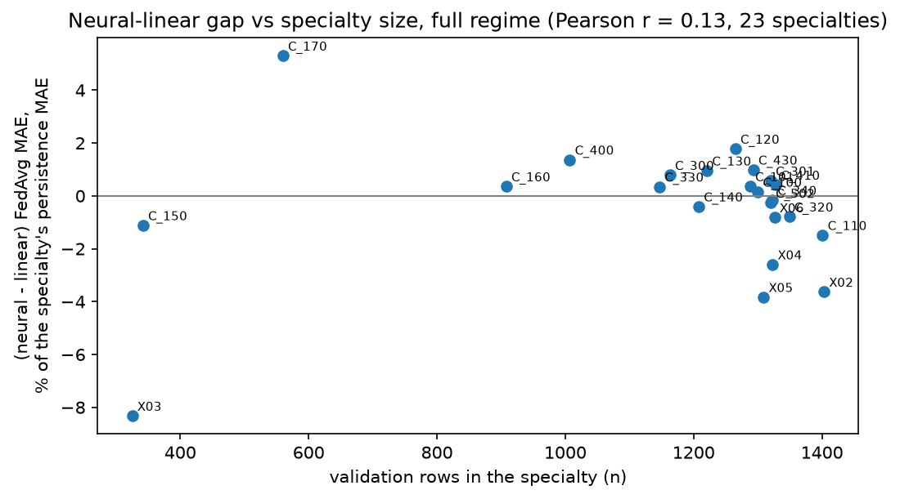

### Sealed year FY 2025-26 (one shot)

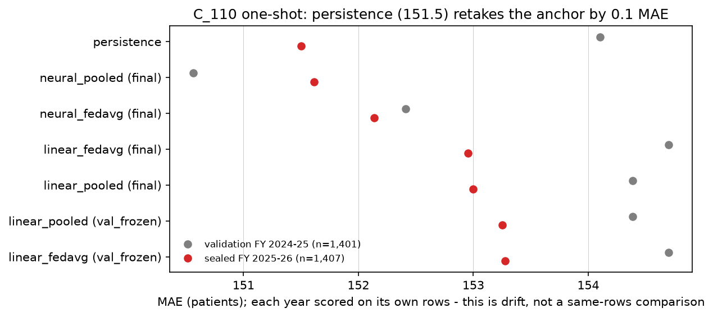
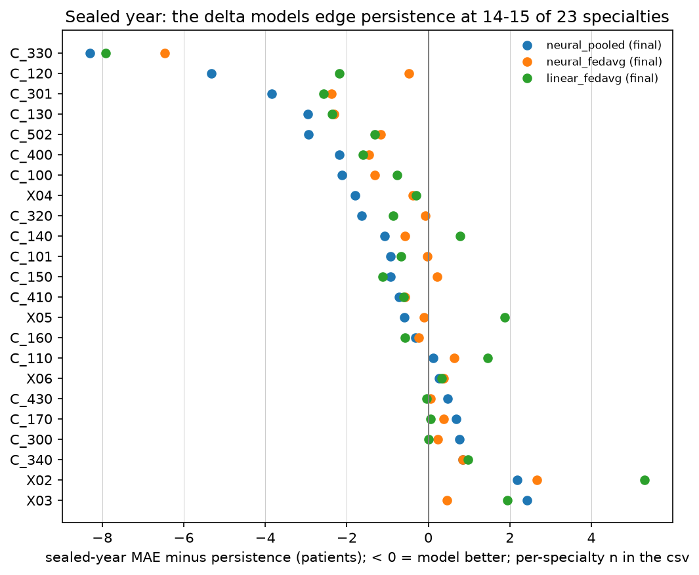
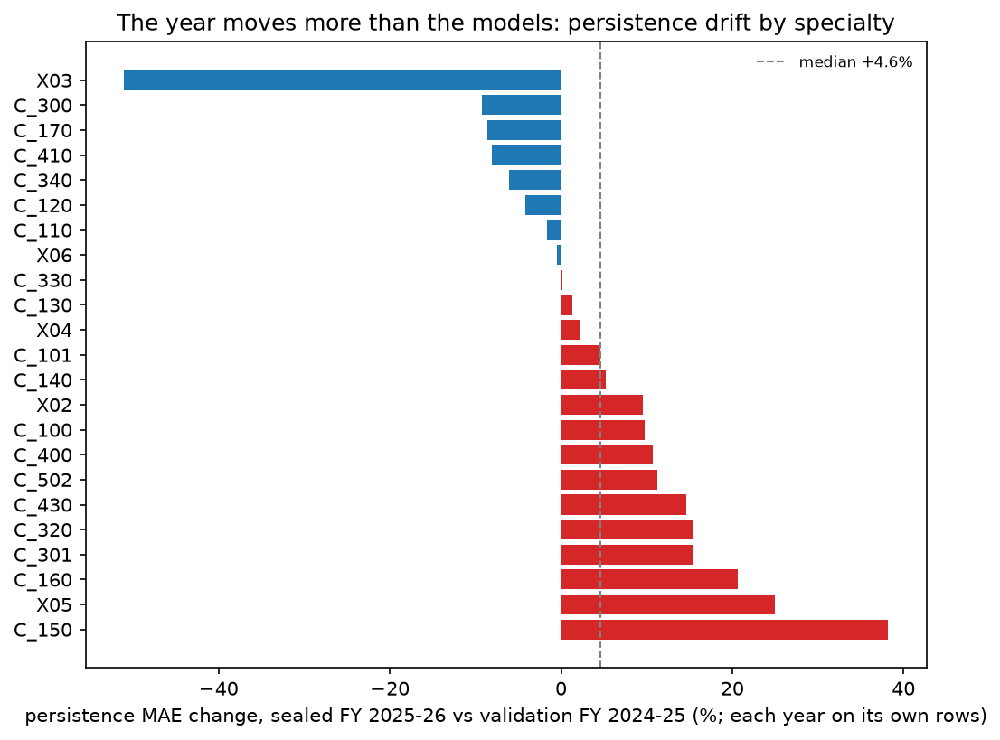

---

## Roadmap (remaining)

### Phase A – Forecasting: closed at every grain measured

Persistence is measured unbeaten at provider, ICB and national grain, horizons 1–12 months, by every available signal (notebooks 07–09, 12). **Persistence + calibrated conformal bands is the forecast layer, final.**

### Phase B – Agent logic for resource allocation (prototype delivered, see section 11)

Prototype in `src/10_agent_logic.ipynb`: declared-weight pressure score, 6-month band, EXPAND/STATUS_QUO decisions, historical simulation with outcome checks. Remaining, guided by what the simulation measured:

- **Ratify or revise the declared constants** with the supervisor (weights 0.2/0.6/0.2; thresholds 0.70/0.40/1.20/1.05/0.80).
- **Drop growth-risk conditions** — measured to select no extra realized growth (random walk) — and condition rules on current pressure and its persistence (consecutive high-pressure months).
- **Redesign REDISTRIBUTE triggers** so they can actually fire (relative or per-provider bands, not one absolute pooled band), and add the receiving side: which under-pressure neighbours (same ICB, occupancy slack) absorb the demand, including the independent-sector option.
- **Board agent**: aggregate provider signals to ICB level.
- All four pending calls (constants, receiving side, multi-seed check, non-C_110 model layer) are collected with their stored evidence in `docs/supervisor_decision_sheet.md` — notebook 15 freezes whatever is ratified.
- **Decided 2026-07-30** (project owner; see the decision sheet's "Decisions" section and section 18): constants ratified as declared and frozen in `src/15_agent_rules_frozen.ipynb`; receiving side stays in-ICB with the arithmetic minimum group of 4; the redesign ideas above (growth-risk drop, relative bands, board agent) are deferred to post-write-up work. Notebook 17 ran 2026-07-30 (section 20) — only the write-up remains.

---

### Phase 5 – Federated learning (scale-up)

Phases 1 + 2 delivered in `src/11_federated_learning.ipynb` (section 12): the non-IID failure was measured (level-FedAvg 186.5) and repaired (delta-space federation 154.0 ≈ pooled 153.8). Multi-specialty scale-up delivered in `src/14_fl_scaleup.ipynb` (section 15): the repair generalizes across all 24 specialties at the 149 public `fl_client` providers. Neural clients delivered in `src/16_fl_neural_clients.ipynb` (section 16): neural ≈ linear in aggregate, with a single-seed sub-persistence C_110 result pending a declared robustness check. The multi-seed check ran 2026-07-30 (`src/19_neural_c110_multiseed.ipynb`, section 19) and **confirmed** the C_110 result in the full regime. Remaining: widening the pool to the 243 independent `fl_client` providers (RTT series, no KH03 capacity). Original design questions still standing:

- Treating each hospital (or ICB) as a **local node**:
  - Local model trained on its own RTT (+ KH03) time series.
- A central server:
  - Aggregates model updates (e.g. FedAvg) to form a global model.
- Research questions:
  - Does FL improve prediction vs purely local models?
  - Do model parameters shift between pre‑ and post‑Covid regimes in a systematic way?
  - How can the board agent use FL outputs to guide system‑wide capacity planning?

---

## How to run (high level)

1. **Environment**
   - Python 3.12 venv at `nhs_FL_agentic/` (kernel: "Python (nhs_FL_agentic)").
   - Installed: `pandas`, `numpy`, `matplotlib`, `requests`, `beautifulsoup4`, `openpyxl`, `xlrd` (KH03 spreadsheets), `ipykernel`, `nbconvert`, `scikit-learn` (gradient boosting, notebook 07), and `torch` (CUDA 12.8 build, verified on the RTX 4060) for the later FL phase.

2. **Data**
   - Run `src/01_fetch_dataset.ipynb` to download RTT, ODS, and KH03 data into `data/`.

3. **EDA & processing**
   - Run notebooks in order (each is verified by a headless `jupyter nbconvert --execute` run on the real data):
     - `01_fetch_dataset.ipynb`
     - `02_eda_dataset.ipynb`
     - `03_provider_flags.ipynb`
     - `04_baseline_forecasting.ipynb`
     - `05_kh03_beds.ipynb`
     - `06_merge_canonical.ipynb`
     - `07_beat_persistence.ipynb`
     - `08_part3_flows.ipynb`
     - `09_longer_horizons.ipynb`
     - `10_agent_logic.ipynb`
     - `11_federated_learning.ipynb`
     - `12_coarser_grain.ipynb`
     - `13_report_figures.ipynb` (report-only: builds `output/` from the stored csvs)
     - `14_fl_scaleup.ipynb`
     - `15_agent_rules_frozen.ipynb` (constants ratified 2026-07-30 — proven by assert to reproduce 10's stored decisions)
     - `16_fl_neural_clients.ipynb`
     - `17_sealed_year_eval.ipynb` (the sealed-year one-shot — run exactly once, 2026-07-30; never re-run)
     - `18_extract_figures.ipynb` (harvests every stored notebook image into `output/figures/from_notebooks/`)
     - `19_neural_c110_multiseed.ipynb` (declared 3-seed check — the C_110 neural result is confirmed in the full regime)

4. **Outputs**
   - Processed data: `data/processed/` (canonical panel: `rtt_kh03_canonical_panel.csv`)
   - Manifests and reference tables: `data/reference/`
   - Figures and tables: embedded in the notebooks' stored outputs; paper-ready figures and evaluation tables under `output/figures/` and `output/evals/` (provenance manifest: `output/README.md`).
   - Results summary: `docs/eda_rtt_summary.md`; pipeline design record: `docs/idea_canonical_pipeline.md`.

---

## Design principles

- **Trust nothing, measure everything**  
  Every claim about the data (schema breaks, aggregate rows, part types) is backed by code and assertions, not assumptions.

- **Raw data is immutable**  
  All cleaning and transformation happens in separate notebooks that write to `data/processed/`, never back into `data/raw/`.

- **Reproducibility over cleverness**  
  Clear, linear notebooks; explicit column contracts; saved manifests and hashes.

- **Human intuition first**  
  No “vibe coding” or black‑box pipelines at this stage. Each transformation is inspected, justified, and tested.

---

## Notes on independent providers

- RTT data includes both **NHS trusts** and **independent providers** delivering NHS‑funded care.
- Our audit shows:
  - Independents are 458 of the 651 provider codes but hold only **5.5%** of the total waiting list (denominator: all patient‑months in the panel).
  - They have **no KH03 capacity data** (KH03 is an NHS‑trust return), so their capacity columns are empty in the canonical panel.
- We **keep** them in the dataset but:
  - Flag them (`is_public`).
  - Analyse them separately where relevant.
  - Do **not** treat them as a simple capacity buffer without evidence.

---

## References

- NHS England, *Referral to Treatment (RTT) Waiting Times*  
  https://www.england.nhs.uk/statistics/statistical-work-areas/rtt-waiting-times/
- NHS England, *Organisation Data Service (ODS)*  
  https://www.england.nhs.uk/nhs-it/standards-and-guidance/organisation-data-service-ods/
- NHS England, *Bed Availability and Occupancy (KH03)*  
  https://www.england.nhs.uk/statistics/statistical-work-areas/bed-availability-and-occupancy/