# fedOPD

**Federated forecasting and agentic capacity allocation for NHS outpatient demand.**

Every hospital helps train one shared demand model without surrendering a row of data, and an
agent turns the resulting forecasts into evidenced capacity requests that escalate up the real
NHS hierarchy — trust → ICB → national — to a human board.

---

## The operational problem

A multi-site health system has to decide, month by month, where capacity is short and where to
direct it: which service at which hospital is falling behind, whether the shortfall is a blip or
a trend, and whether to fix it internally or buy it in. Today that judgement is manual, slow, and
made from stale local views.

This project builds the decision loop that does it systematically: **sense demand → compare
against capacity → project the queue → raise an evidenced request → let a human board decide →
allocate → release when recovered.**

Hospital networks must plan capacity department by department, which requires a demand forecast
for each — but a single central model is both impossible and inadequate. Sites will not pool raw
activity data, and they differ widely in size and casemix, yet their demand moves together, so
there is shared structure worth learning jointly. That is exactly the cross-silo federated
learning regime.

---

## The two engines

| | **Federated forecaster** (perception) | **Agentic layer** (decision) |
|---|---|---|
| What it does | Every trust helps train one shared neural demand model per department without surrendering raw data, then fine-tunes locally | Holds the operational state of each trust × department and turns forecast vs capacity into an action |
| Why federated | Sites won't pool data; they differ in size and casemix but their demand co-moves — shared structure worth learning jointly, local level worth preserving | — |
| State it carries | — | forecast demand in, trailing throughput out, backlog stock, the bed-linked admission queue, the >18-week count |
| The glue | — | `backlog(t+1) ≈ backlog(t) + demand − completions` |
| Output | A per-site forecast informed by the whole system's experience | A capacity gap in **treatments per month** (admitted vs non-admitted, never literal beds), classified transient / sustained / regime change |

On a sustained gap the agent raises a structured request up the real hierarchy: **trust → ICB →
national**.

### The human stays where judgement lives

The ICB tier is human-in-the-loop. The agent proposes with evidence — forecast trajectory,
backlog trend, months in breach, the ask — and the board approves, refuses, or defers. The
board's view is two-sided because the data is: internal trust capacity, plus the independent
sector's aggregate volume in that ICB as revealed, purchasable substitution capacity. That is the
allocate-or-buy decision made concrete. De-escalation is symmetric: gaps that stay closed release
their allocation.

**Independent providers are private companies delivering NHS-funded care, not NHS bodies.** That
distinction is the whole reason the project carries two separate flags rather than one: an ICB can
*buy* capacity from an independent provider, but it cannot *direct* NHS staff and capital into one.
So `fl_client` marks who trains the forecaster (the 150 eligible public sites) and `allocatable` marks who
can receive capacity (public only). Neither implies the other.

**Measured constraint on how fast the buy side responds.** The intuitive mechanism, namely public backlog
rises, so work is bought from independents that month, was tested and **is not present in the
data**. Correlating the monthly change in independent share against the change in public backlog
across the 18 named specialties gives +0.08 contemporaneously and essentially zero at 3, 6 and 12
months (7 of 18 specialties positive at 6 months, i.e. chance). What is real is the *slow* shift:
independent share of ophthalmology moved 6.2% → 19.65% across the window. Substitution operates on a
multi-year contracting timescale, consistent with NHS's own encouragement of "long-term contractual
relationships" with the sector. **The agent must therefore treat independent volume as a standing
stock of purchasable capacity, not as a lever that responds inside a monthly decision loop.**

---

## The testbed

England's NHS Referral-to-Treatment return, **96 monthly files, April 2018 – March 2026**,
spanning the COVID shock.

| RTT concept | Project role |
|---|---|
| NHS trust | a federated client |
| Treatment function | a department |
| New RTT periods (`Part_3`) | the demand signal — the forecast target |
| Incomplete pathways (`Part_2`) | the backlog |
| Completed pathways (`Part_1A`/`1B`) | throughput |

Reduced to a single validated table of trust × department × month. The framing is operations
research plus distributed machine learning, not clinical work.

Success is measured honestly, against three baselines:

1. **Persistence** — a hard naive baseline, not a strawman.
2. **Isolated per-hospital training** — does federation actually beat going it alone?
3. **Pooled central training** — the privacy-violating ceiling.

### COVID is the built-in stress test

The shock sits inside the window on purpose. The forecaster has to be robust to it; the agent
gets *evaluated* on it — detect the collapse as an anomaly, escalate through the sustained
recovery, normalise when it settles. That arc, demand signal to board decision and back down,
with no raw data ever leaving a site, is the project.

---

## Scope, deliberately bounded

- **The currency is operational, not financial** — treatments, queues, waiting-time standards,
  human factor, efficiency. Expansion and revenue are out, because the data has no money in it.
- **The clients are the 150 public sites still reporting with at least 48 months of history.** The
  earlier rule of full 96-month history gave 126 sites but discarded 20% of public demand.
  Independents stay in the data —
  they absorb a real and growing slice of demand, ophthalmology fastest — but enter as context,
  not as clients.
- **The forecastable universe is 18 named specialties plus one merged `X_OTHER`**, so the tiers
  reconcile to 100% of demand and the escalation arithmetic actually adds up.

---

## Repository

Each notebook is named for exactly what it does, and does only that.

| Notebook | Responsibility |
|---|---|
| [`src/01_fetch_dataset.ipynb`](src/01_fetch_dataset.ipynb) | **Acquisition only.** Scrapes the eight NHS RTT financial-year pages, downloads the 96 monthly Full CSV archives, extracts them, builds the provider→ICB reference from the ODS ORD API, and fetches the KH03 bed workbooks. Idempotent: reruns resume rather than restart. |
| [`src/02_inspect_dataset.ipynb`](src/02_inspect_dataset.ipynb) | **Validation and inspection only.** Proves the download is intact, then establishes what is in the data — provider census, department roster, hierarchy, per-region and per-department averages, the independent-sector gate, and the eight-year format-drift audit. Transforms nothing. |
| [`src/03_data_processing.ipynb`](src/03_data_processing.ipynb) | **Transformation.** Merges the 96 monthly files into one canonical table on an explicit column contract, reconciles the April 2021 schema break, resolves the ICB escalation key, and builds the federation panel. |
| [`src/04_eda.ipynb`](src/04_eda.ipynb) | **Exploration.** The 18-week series across the window, the independent-substitution lag test, and the accounting identity worked through one real trust. Reads the canonical table, writes nothing back. |
| [`src/05_baselines.ipynb`](src/05_baselines.ipynb) | **The bar.** Four baselines, the three-way train/validation/test split, MASE / RMSE / the two R² values, the growth-detection scoring, and the normalised dataset export. Nothing downstream may skip this. |
| [`src/06_federated_forecast.ipynb`](src/06_federated_forecast.ipynb) | **The federation plane.** FedAvg over the site silos, hand-implemented in torch, against `local`, `central` and post-training baselines. Scores point accuracy and the up/flat/down direction call. |
| [`src/07_agentic_layer.ipynb`](src/07_agentic_layer.ipynb) | **The agentic plane.** State vector, split removal term, backlog projection, gap classification, site → region → group escalation, and a back-test of the projection against months that already happened. |
| [`src/08_algorithm_comparison.ipynb`](src/08_algorithm_comparison.ipynb) | **Eleven configurations**, one factor at a time from a declared reference: anchoring, architecture, FL algorithm, feature set. Every method on a **matched training budget** — the confound 06 left open. |
| [`src/09_allocation_policies.ipynb`](src/09_allocation_policies.ipynb) | **Seven allocation policies** scored against hindsight at five budget levels, using only information available on the decision date. Includes the forecast-led policy the whole system exists to enable. |
| [`src/10_training_length.ipynb`](src/10_training_length.ipynb) | **Does longer training help?** One continuous run to 60 rounds evaluated every round, with training loss alongside, plus a sweep over local epochs. |
| [`src/11_postcovid_training.ipynb`](src/11_postcovid_training.ipynb) | **Does cutting the COVID months help?** Six training-start cutoffs at three lookbacks, plus every algorithm re-run on 2022-onward data. |

### How it fits together

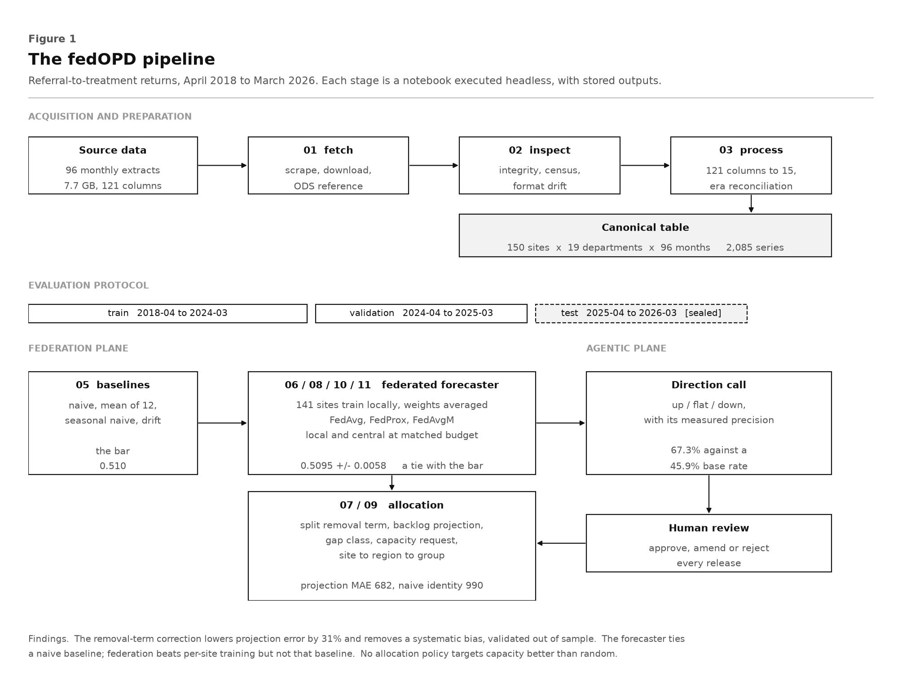

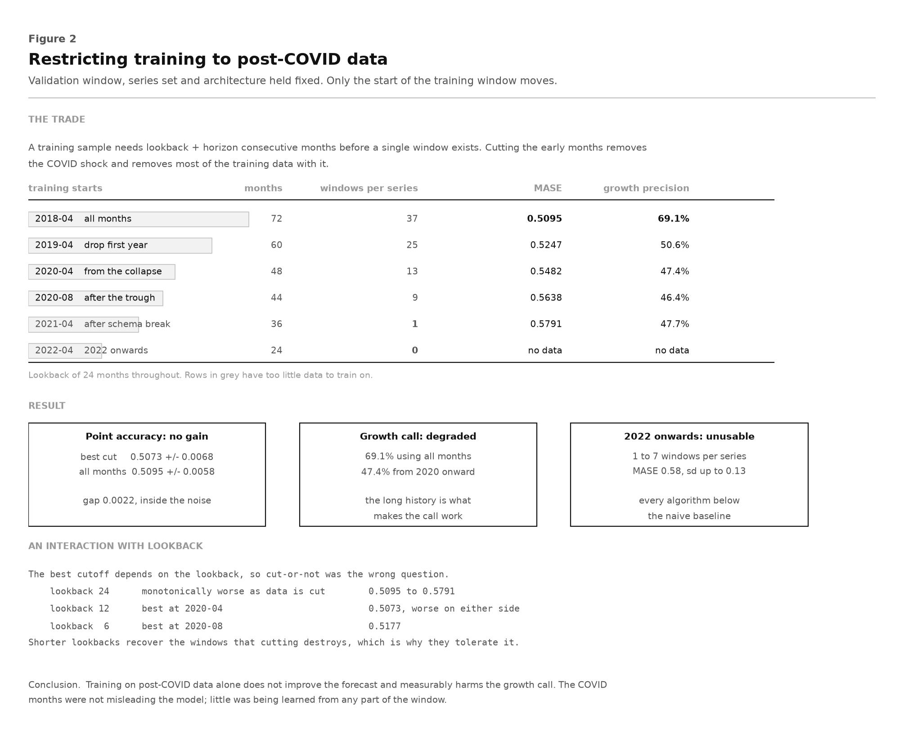

### What the data looks like

Every image below is generated by the notebook named beside it and is regenerated on each run; none is
drawn by hand.

**The operating environment (`04`).** The waiting list runs 4.0m to 7.8m, and the share seen within 18
weeks never returns to the 92% standard. The list peak and the performance trough are 3.1 years apart,
so they are not one event.

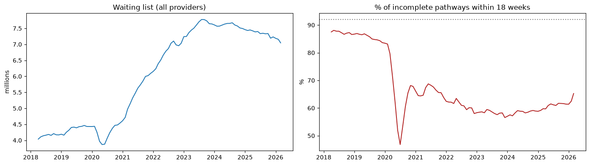

**The identity leaks (`03`).** The standard `backlog + demand − completions` projection pulls away from
the actual waiting list monotonically. This gap is Finding 1, and closing it is the project's clearest
positive result.

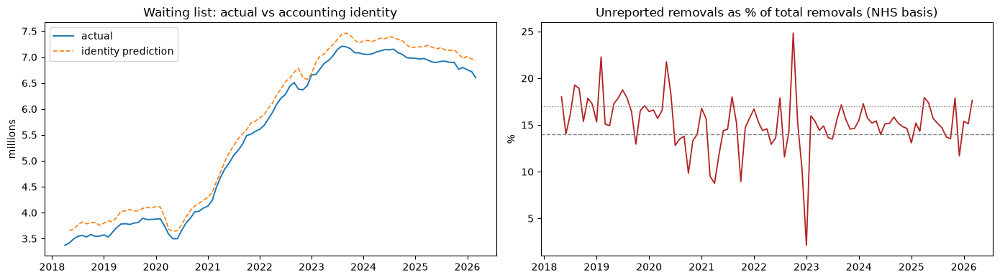

**The buy side does not respond monthly (`02`).** Independent share drifts from 6.20% to 7.70% overall
and 6.2% to 19.65% in ophthalmology — a multi-year contracting shift, not a monthly valve.

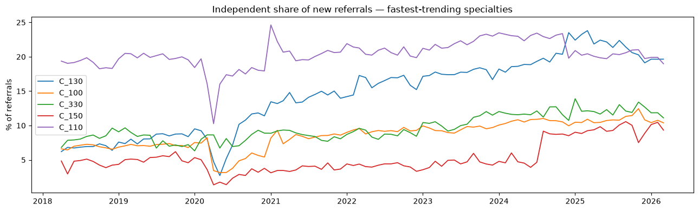

### What the models did

**Every configuration, both metrics (`08`).** Left, point accuracy against the naive baseline; right,
precision on the growth call. The two orderings are not the same, which is the point.

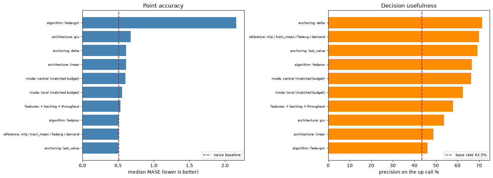

**Longer training makes it worse (`10`).** Validation error against total training work, for three
local-epoch settings. It bottoms out around round 13 and then climbs, while training loss keeps
falling.

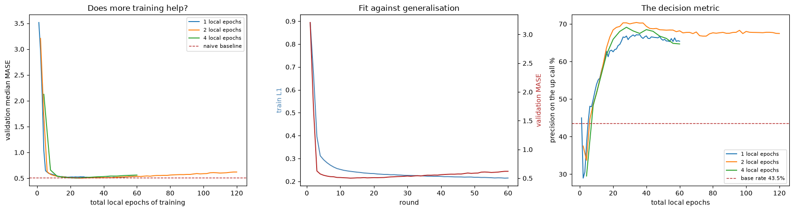

**Cutting the COVID months does not help (`11`).** Six training-start cutoffs at three lookbacks. Less
history is worse on every measure, and the growth call degrades fastest.

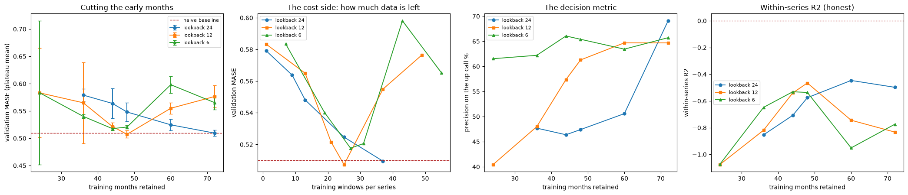

**Direction, not magnitude (`05`).** Predicted against actual growth with the ±5% decision bands. The
cloud is wide; the useful signal is which quadrant a service lands in, not how far it moves.

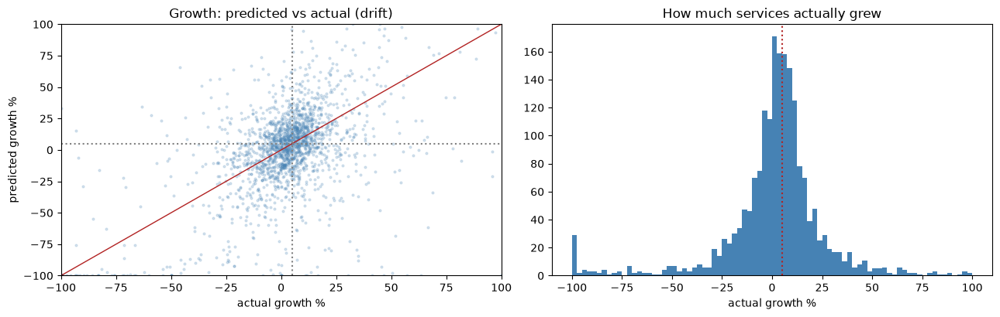

### What the agent found

**There is no internal slack (`07`).** Services against the 18-week standard, now and projected. The
distribution sits far below 92%, which is why the first two escalation tiers have nothing to settle.

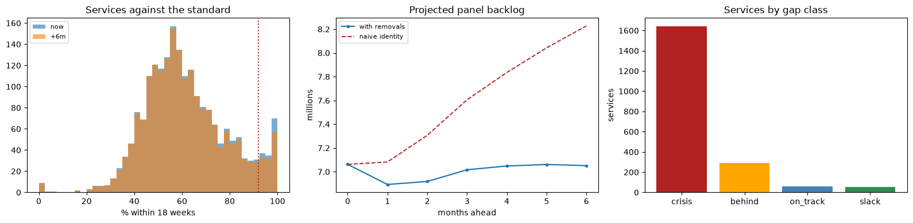

**No allocation policy beats random targeting (`09`).** Overlap with the hindsight target across five
budget levels. This is the sharpest negative result in the project: a good demand forecast does not
tell you where to put capacity, because demand growth and breach growth are different quantities.

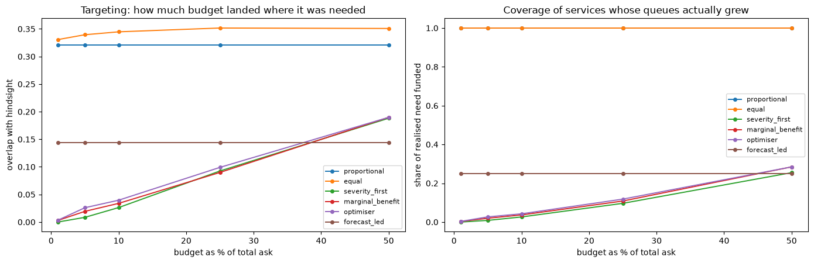

### Every full-dataset run, in one table

All figures are **validation-year** (2024-04 to 2025-03), 2,085 series. The test year is sealed and has
never been opened. Lower MASE is better; within-series R² is the honest one and is negative for
everything.

| Run | Configuration | MASE | RMSE | Pooled R² | Within R² |
|---|---|---|---|---|---|
| **05** | naive (repeat last value) — **the bar** | **0.5103** | 72.78 | 0.9675 | −0.6667 |
| 05 | mean of last 12 | 0.5121 | 72.17 | 0.9655 | −0.4917 |
| 05 | seasonal naive | 0.6166 | 87.27 | 0.9489 | −1.4877 |
| 05 | drift | 0.6406 | 88.34 | 0.9360 | −1.4505 |
| 06 | fedavg *(unmatched budget, 30 rounds)* | 0.5527 | 74.72 | 0.9645 | −0.7812 |
| 06 | fedavg_ft — post-training | 0.5680 | 79.60 | 0.9593 | −0.9356 |
| 06 | local *(unmatched)* | 0.5558 | 77.10 | 0.9542 | −0.7857 |
| 06 | central *(unmatched)* | 0.7300 | 102.22 | 0.9306 | −2.4157 |
| **08** | **last-value anchoring** — best overall | **0.5030** | 70.33 | — | −0.4997 |
| 08 | fedprox — **best RMSE** | 0.5075 | **69.04** | — | −0.5130 |
| 08 | mlp / fedavg reference — **best R²** | 0.5072 | 69.66 | — | **−0.4876** |
| 08 | + backlog + throughput features | 0.5334 | 71.93 | — | −0.6186 |
| 08 | local *(matched budget)* | 0.5562 | 77.41 | — | −0.8024 |
| 08 | central *(matched budget)* | 0.6034 | 87.91 | — | −1.3544 |
| 08 | linear | 0.6110 | 86.17 | — | −1.1834 |
| 08 | GRU | 0.6757 | 86.40 | — | −1.2861 |
| 08 | fedavgm — **diverges** | 2.1586 | 265.35 | — | −24.9649 |
| 10 | fedavg, plateau over rounds 8–20 | **0.5095 ± 0.0058** | — | — | — |
| 11 | best post-COVID cut (L=12, from 2020-04) | 0.5073 ± 0.0068 | — | — | — |

### How much history should the model get?

Same validation year, same 2,085 services, same network. The **only** thing that changes is how far
back the model may look when learning. `L` is the lookback in months; `W/s` is how many training
examples that actually yields per service.

**Terminology:** the *dataset* is 8 years (Apr 2018 – Mar 2026). The *training window* is at most
**6 years** of that (Apr 2018 – Mar 2024), because a year is held out for validation and a year is
sealed as test.

**At a 24-month lookback — removing history hurts on every measure:**

| History given | W/s | MASE | RMSE | Pooled R² | Within R² | Growth |
|---|---|---|---|---|---|---|
| **6 years (all of it)** | 37 | **0.5095** | **69.78** | 0.9697 | −0.4980 | **69.1%** |
| 5 years (from Apr 2019) | 25 | 0.5247 | 69.78 | 0.9626 | −0.4466 | 50.6% |
| 4 years (from Apr 2020) | 13 | 0.5482 | 73.06 | 0.9583 | −0.5757 | 47.4% |
| 3 yr 8 mth (from Aug 2020) | 9 | 0.5638 | 75.98 | 0.9555 | −0.7078 | 46.4% |
| 3 years (from Apr 2021) | 1 | 0.5791 | 79.27 | 0.9560 | −0.8536 | 47.7% |
| 2 years (from Apr 2022) | **0** | *cannot be trained — no example fits* | | | | |

**At shorter lookbacks the picture inverts**, because a shorter lookback needs fewer months per example
and survives a cut that starves the long one:

| History given | L | W/s | MASE | RMSE | Within R² | Growth |
|---|---|---|---|---|---|---|
| 4 years (from Apr 2020) | 12 | 25 | **0.5073** | **69.63** | −0.4656 | 61.3% |
| 3 yr 8 mth (from Aug 2020) | 6 | 27 | 0.5177 | 70.27 | −0.5314 | 66.1% |
| **2 years (from Apr 2022)** | 12 | 1 | 0.5833 | 82.07 | −1.0766 | **40.4%** |
| **2 years (from Apr 2022)** | 6 | 7 | 0.5835 | 79.55 | −1.0745 | 61.5% |
| *naive baseline (no training)* | — | — | *0.5103* | *72.78* | *−0.6667* | *68.7%* |

**The 2022-onward subset is worse on every measure.** RMSE 69.78 → 79.6–82.1, within-series R² doubles
in badness, and at a 12-month lookback the growth call reaches **40.4% — below the 45.9% base rate**,
i.e. worse than calling every service "growing".

**And note what pooled R² does.** It sits between 0.956 and 0.970 for *every row above*, including the
untrainable one. It cannot tell a good configuration from a useless one. Within-series R² ranges −0.45
to −1.08 and orders them correctly.

**How to read it.** The 08 rows are the fair comparison — every method there gets the same training
budget, which 06 did not. The three best configurations sit within 0.005 of each other and within
0.008 of the naive baseline, on one seed. **That is a tie, not a win.** Notebook 10 makes it explicit:
across thirteen round counts the plateau is 0.5095 ± 0.0058 against the baseline's 0.5103.

**Pooled R² is shown only to be dismissed.** The same forecast reports 0.9675 pooled and −0.6667
within-series. Pooled R² largely measures that the model knows which site is large.

### Results so far

The full account, written for a reader starting from zero, is
**[`docs/fedOPD_report.pdf`](docs/fedOPD_report.pdf)** — 34 pages, 18 figures, 28 tables, every number
traceable to a stored notebook output.

Everything below is scored on the **validation** year (2024-04 to 2025-03). The test year
(2025-04 to 2026-03) is sealed and has never been opened.

**1. The backlog identity leaks, and correcting it matters.** The standard
`backlog + demand − treatments` projection over-predicts in **95 of 95** months. Splitting the leak by
NHS England's own recorded reasons — 49% of it is treatment that happened and was filed late — and
adding that half back to capacity, then back-tested six months forward on 2,046 services:

| Projection | Per-service MAE | Bias | Group total projected | Actual |
|---|---|---|---|---|
| **With removal term** | **682** | **−16** | 7.05m | 7.08m |
| Naive identity | 990 | +565 | 8.24m | 7.08m |

31% lower error, and the systematic bias disappears.

**2. A federated neural forecaster does not beat repeating last month.** 2,085 series, median MASE:
`naive` **0.510**, `mean12` 0.512, `fedavg` 0.553, `fedavg_ft` 0.568, `central` 0.730. Only **9.3%** of
services achieve a within-series R² above zero. Reported as the null it is.

**3. The metric decides the winner.** Scored on the question a board actually asks — is this department
growing? — the ordering inverts. `drift`, *worst* on MASE, is the best broad detector (66.3% direction
accuracy). `mean12`, second-best on MASE, has **zero recall** — it never calls growth at all. And the
post-trained federated model becomes a selective, high-precision detector:

| Model | Precision on "growing" | Lift over 45.9% base rate | Coverage |
|---|---|---|---|
| `fedavg_ft` | **67.3%** | +21.4pp | 13.1% of services |
| `local` (no sharing) | 55.5% | +9.6pp | 23.8% |

Sharing weights buys roughly **ten points of precision** over each site working alone — and it shows up
on the decision metric, not on forecast error.

**4. There is no internal slack to reallocate.** At the decision month, 80.3% of services are in
crisis and 51 have slack. Total ask **419,220** treatments/month against a total offer of **657** —
0.16%. The first two escalation tiers have almost nothing to settle, which inverts the intuition the
tiered design was built on.

**5. Predicting the queue instead of demand makes allocation work — and the variable, not the
model, carries the gain** (`12`). Queue-led allocation scores **0.472** budget precision at every
budget level against random's 0.439 and the demand signal's 0.390; the no-learning momentum control
scores 0.462, so the trained model adds only +0.010 on top of switching variable.

**6. The federation claims hold at two origins and fail in the recovery era** (`13`, 45 runs:
5 seeds × 3 origins). At 2023-04 and 2024-04, `fedavg` beats `local` and `central` clearly; at
2022-04 — scored on the surge year in which 51.2% of services grew — every claim flips, and the
up call drops below its base rate. Federation's advantage is a property of the stable regime.

**7. The practical barriers are cheap** (`15`). 20% participation per round, update clipping and
server-side noise at up to the clip bound cost at most half a precision point. And **8.** at spike
time, temporary-versus-sustained is a **coin flip** (`14`: 49.0% of 22,680 spikes revert within 3
months) — D-07's absorption rule survives on the cheapness of its error, not on accuracy. There is
also no 80%-precision operating point at any usable coverage; the curve tops out near 67% at 13%.

**9. Boards should be handed the queue's own trajectory** (`16`). The demand-led shortlist never
beats a random board on queue vindication; the queue-momentum board is vindicated at 82.7–96.6%
against bases of 42.3–77.1% (part of that margin is queue persistence itself, stated in the
notebook), the trained queue model sits **below** momentum at all three origins (69.0–81.1%), and
severity-first collapses below random at 2024-04. The cost-optimal shortlist size is swept at
declared miss-to-waste ratios: a policy choice, priced. `07`'s release now carries both
calls: demand direction (which levers exist) and queue growth (where budget goes).

**One thing that must not be read from these numbers.** Growth *magnitude* is not predicted; only
direction, and only modestly.

What NHS England says about the collection, read from their own documents with every claim cited, is
in [`docs/RTT_SOURCE_DOSSIER.md`](docs/RTT_SOURCE_DOSSIER.md). The reasoning behind every decision, including
the failures and dead ends, is in [`WORKLOG.md`](WORKLOG.md). Working conventions are in
[`CLAUDE.md`](CLAUDE.md).

### Data layout

```
data/
  rtt_csv/      96 monthly RTT full extracts (~7.7 GB) — the source of truth
  reference/    provider_census.csv, trust_icb.csv, provider_types.csv,
                monthly_summary.csv, tf_month_demand.csv, findings.csv
  canonical/    rtt_canonical.parquet   the merged RTT table, 15 columns
                rtt_normalised.csv      raw + z-scored measures, scaler fitted on train only
                rtt_panel.parquet       the 150 x 19 x 96 federation cube
                provider_dim.csv        one row per provider
                national_monthly.csv    national series + identity residual
  kh03/         61 quarterly overnight bed workbooks
```

The downloaded archives are deleted once `02_inspect_dataset.ipynb` has CRC-verified them against
the extracted files; the CSVs are the only copy retained.

### The canonical table

One row per **provider × department × month**. 121 raw columns reduce to 15, and a column is kept
only if some part of the system above consumes it — the contract, with the measurement justifying
every drop, is a section of `03_data_processing.ipynb`.

| Column | Meaning | Consumed by |
|---|---|---|
| `month`, `provider_code`, `dept` | the key | one series per client × department |
| `demand` | new RTT periods | **the forecast target** |
| `completed_admitted`, `completed_nonadmitted` | completed pathways, split | the capacity ask, in treatments per month |
| `completed` | their sum | throughput term of the accounting identity |
| `waiting` | incomplete pathways | backlog stock |
| `waiting_gt18` | of those, past 18 weeks | the standard the agent projects against |
| `waiting_gt52` | of those, past 52 weeks | breach severity |
| `waiting_dta` | of those, with a decision to admit | the bed-linked admission queue |
| `sector` | `public` / `independent` | independents as purchasable substitution capacity |
| `icb` | resolved commissioner parent | the escalation key |
| `fl_client` | eligible to train (150 public sites) | selects federation clients — a flag, never a filter |
| `allocatable` | eligible to receive capacity (196 public bodies) | the allocation targets; independents are excluded by construction |

---

## Facts about the data that shape the build

Measured in `02_inspect_dataset.ipynb` and `03_data_processing.ipynb`, not assumed. Full detail, with
the numbers and the reasoning, is in `WORKLOG.md`.

- **`C_999` is an aggregate row, not a department.** The `Treatment Function Code` column contains
  a code named "Total" that is the exact sum of the other specialties, published as extra rows in
  the same table. Verified exact across every month, part type and provider. Failing to exclude
  it doubles the England waiting list.
- **The schema changes in April 2021.** 69 columns before, 121 after: the single `Gt 52 Weeks`
  column is replaced by weekly bands running to 104 weeks. The bands below 52 weeks are identical
  in both eras, so the >18-week metric the agentic layer uses is era-stable; only the >52 tail
  needs reconciling.
- **Treatment function *names* changed at the same break, codes did not.** 18 of 24 were renamed.
  Every join is on code; grouping by name silently splits each specialty into two partial
  histories.
- **`Part_3` carries no waiting-time bands, by design** — a new referral has waited ~0 weeks.
  Demand is the `Total All` column alone.
- **The RTT return covers independent-sector providers as well as NHS trusts.** The canonical
  table keeps every provider with a `sector` column; sector filtering is a downstream panel
  decision, not baked into the data. `sector = public` covers ODS primary roles RO197 (NHS Trust)
  and RO107 (Care Trust), the criterion being allocability rather than the role label.
- **The parent organisation stated in the RTT file is not a stable ICB.** It is an NHS *region*
  before 2020 and an ICB after, so the escalation key comes from the ODS `RE5` relationship
  instead, with a fallback only where ODS has no answer.
- **The accounting identity leaks.** `backlog + demand − completions` over-predicts the waiting
  list every month for 95 of 95 months. The residual survives being recomputed on all 653
  providers, so it is genuine attrition — removals, transfers out of RTT, validation, deaths,
  declines — and the decision layer needs an explicit removal term.
- **Every provider count in the project is derivable from `provider_census.csv`** — one row per
  provider code ever seen in RTT, with ODS role, active/retired status, first and last month,
  months present, ICB parent, sector and panel membership.

---

## Environment

Python 3.10 virtualenv at `fed_learning/` (`torch 2.13.0+cu130`, `flwr 1.30.0`, pandas stack,
Jupyter kernel **fed_learning (CUDA)**). The GPU is an A100 80GB reachable only through a MIG
instance. Long jobs run detached under `tmux`. See `CLAUDE.md` for working conventions.
